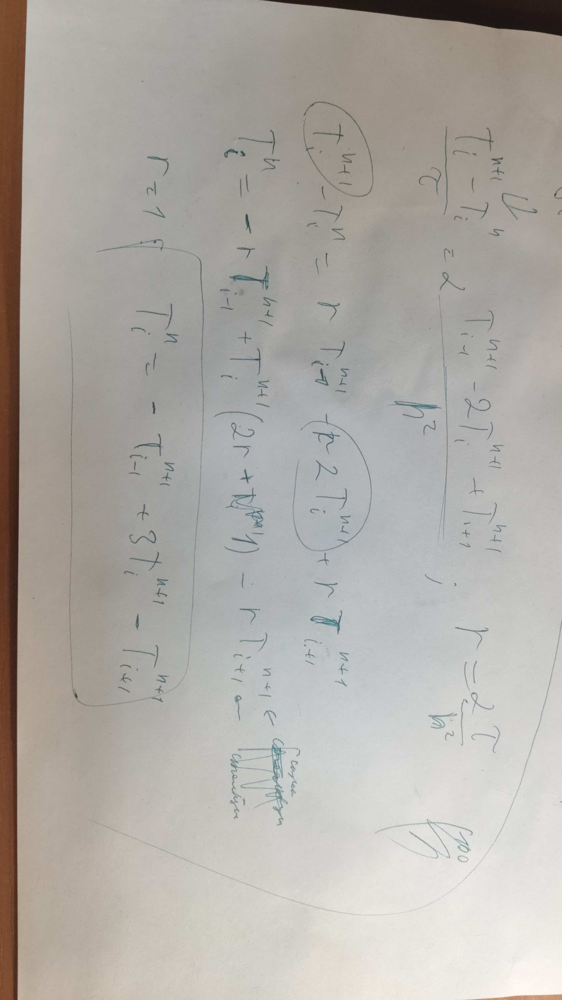

Пусть нижний индекс у T - это положение, а верхний - время.

вывод коэффициентов для трехдиагональной матрицы.

т.к. r = 1, то a = -1, b = 3, c = -1

Написал функцию для прогонки как в презентации (solve_system), функцию чтобы получить температуры в начальной точке.

Увеличил N до 100 и получил странный скачок температуры у холодной части, возможно что-то неправильно. При N=100 h=5см, потребовалось >7000 временных единиц, что много.